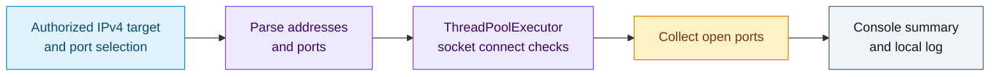
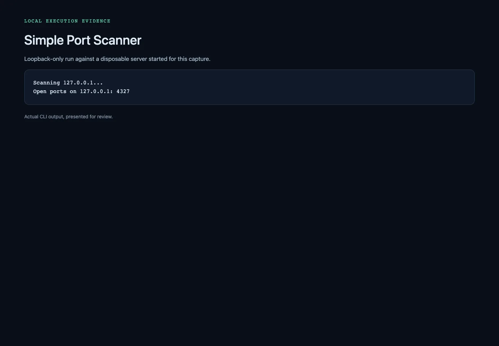

# SimplePortScanner

SimplePortScanner is a lightweight, multi-threaded network port scanner written in Python.  
It supports scanning single IPs, ranges of IPs, or entire subnets, and allows you to scan single ports, ranges of ports, or common service ports.

> **Disclaimer:**  
> This tool is intended for educational purposes and authorized testing only.  
> Unauthorized port scanning is illegal and unethical. Please ensure you have explicit permission before scanning any network or system.

## A bounded TCP-connect scan

The scanner expands an IPv4 target/port selection and checks connections with a thread pool. An open result means a TCP connection succeeded at that moment; it does not identify a service or vulnerability.



For a small loopback-only demonstration, first start a disposable local server in one terminal:

```bash
python3 -m http.server 8765 --bind 127.0.0.1
```

In a scratch working directory, run the scanner against that single port:

```bash
python3 /path/to/simple_port_scanner.py -ip 127.0.0.1 -p 8765 -T 2 -t 0.5
```

Stop the HTTP server with Ctrl+C. The scanner writes `port_scanner.log` in its current working directory. Keep address ranges small: the parser materializes the full range before scanning, and the connection implementation uses IPv4 sockets.

## Features

- **IP Range Input:**  
  Accepts a single IP (e.g., `192.168.1.1`), a dash-separated range (e.g., `192.168.1.1-192.168.1.10`), or a CIDR subnet (e.g., `192.168.1.0/24`).

- **Port Range Input:**  
  Supports single ports (e.g., `80`), ranges (e.g., `20-80`), and well-known service names (e.g., `http`, `ftp`).

- **Multi-Threading:**  
  Uses Python's `ThreadPoolExecutor` to perform concurrent port scans for faster results.

- **Logging:**  
  Scan results are logged to `port_scanner.log` for later review.

## Requirements

- Python 3.x

## Usage

Run the script from the command line:

```bash
python3 simple_port_scanner.py --ip_range <IP_RANGE> --port_range <PORT_RANGE> [--timeout <TIMEOUT>] [--threads <THREAD_COUNT>]
```

## Example
- Scan a single IP for HTTP (port 80):
  ```bash
  python3 simple_port_scanner.py --ip_range 192.168.1.100 --port_range http
  ```

- Scan a range of IPs for SSH (port 22):
  ```bash
  python3 simple_port_scanner.py --ip_range 192.168.1.1-192.168.1.10 --port_range 22
  ```

- Scan a subnet for a range of ports:
  ```bash
  python3 simple_port_scanner.py --ip_range 192.168.1.0/24 --port_range 20-80
  ```

## Installation

1. Clone the repository:
   ```bash
   git clone https://github.com/C0deRhin0/simple-port-scanner.git
   ```

2. Navigate to the project directory:
   ```bash
   cd simple-port-scanner
   ```

3. Running the script:
   Refer to "Example" section

OR you can just download the file in this repo and run it

## License
This project is licensed under the [MIT License](LICENSE).

## Contact

For any inquiries or support, please contact:

- **Author**: C0deRhin0 
- **GitHub**: [C0deRhin0](https://github.com/C0deRhin0)

---

## Captures

Actual scan of a single disposable loopback service.



Full capture descriptions and provenance: [captures.json](docs/screenshots/captures.json).
